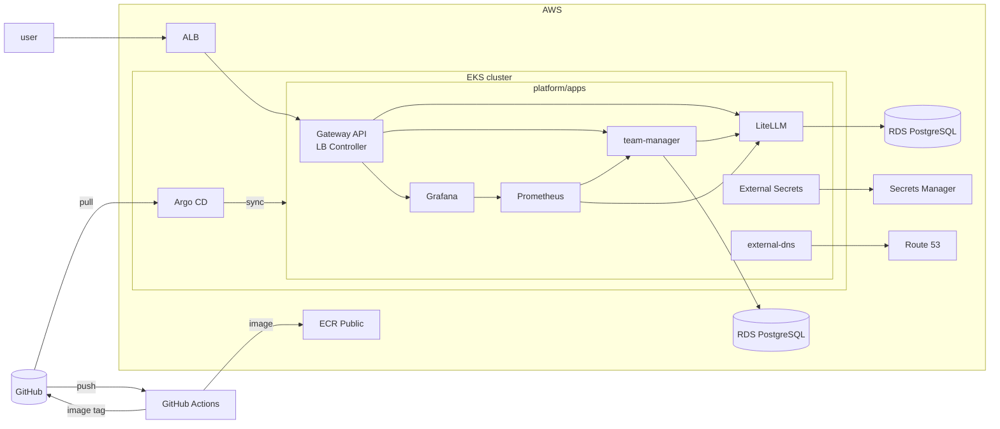

# hackops-ai-platform

hackops-ai-platform is an LLM gateway for hackathons, with per-team API keys, budgets, rate limits, and usage dashboards.
It runs LiteLLM, a team management API, Prometheus, and Grafana on Amazon EKS, managed with GitOps through Argo CD.

## Architecture



## Requirements

- [AWS CLI](https://docs.aws.amazon.com/cli/latest/userguide/getting-started-install.html)
- [Terraform](https://developer.hashicorp.com/terraform/install)
- [kubectl](https://kubernetes.io/docs/tasks/tools/)
- [Helm](https://helm.sh/docs/intro/install/)
- [GitHub CLI](https://cli.github.com/)
- [jq](https://jqlang.org/download/)

## Deploy

1. Fork the repo. Under `platform/`, replace `pluvivanto/hackops-ai-platform` with your fork. Replace the domain in `platform/`, `scripts/`, and `infra/` with yours.
2. Create the DNS zone with `terraform apply` in `infra/dns/`, then delegate your domain to the printed name servers.
3. Set `admin_cidrs` and `alert_email` in `infra/terraform.tfvars`.
4. In `infra/ci.tf`, set the OIDC subject to your repo (`gh api repos/<owner>/<repo>/actions/oidc/customization/sub`). The AWS account needs a GitHub OIDC provider (`token.actions.githubusercontent.com`).
5. Create the cluster and bootstrap Argo CD:

   ```sh
   cd infra && terraform apply && cd ..
   aws eks update-kubeconfig --name hackathon --region ap-northeast-1
   helm install argocd argo-cd --repo https://argoproj.github.io/argo-helm --version 10.11.6 -n argocd --create-namespace
   kubectl apply --server-side -f https://github.com/kubernetes-sigs/gateway-api/releases/download/v1.6.3/standard-install.yaml
   kubectl apply -f platform/root.yaml
   ```

6. Point CI at your account: set the `AWS_ROLE_ARN` secret to `terraform -chdir=infra output -raw github_ci_role_arn`, replace the image in `.github/workflows/` and `platform/team-manager/` with `terraform -chdir=infra output -raw team_manager_image`, and push.
7. Build the team-manager image with `gh workflow run team-manager.yml`. Run it again after every cluster rebuild.
8. Confirm the SNS subscription email.
9. Run `./scripts/test-teams.sh` once all apps are healthy.

Endpoints:

- `https://argocd.<domain>`
- `https://grafana.<domain>`
- `https://alertmanager.<domain>`
- `https://llm.<domain>`
- `https://team.<domain>`

## Usage

```console
$ curl https://team.<domain>/teams \
    -H "Authorization: Bearer <admin token>" \
    -d '{"display_name": "Team Foo"}'
{"id":"team-<id key>","display_name":"Team Foo",...}
$ curl -X POST https://team.<domain>/teams/team-<id key>/keys \
    -H "Authorization: Bearer <admin token>"
{"key":"sk-..."}
$ curl https://llm.<domain>/v1/chat/completions \
    -H "Authorization: Bearer sk-..." \
    -H "Content-Type: application/json" \
    -d '{"model": "<model>", "messages": [...]}'
$ curl -X DELETE https://team.<domain>/teams/team-<id key> \
    -H "Authorization: Bearer <admin token>"
```

Calling `POST /teams/{id}/keys` again revokes the old key.

Models are configured in `platform/apps/litellm.yaml`.

## License

[MIT](LICENSE)
