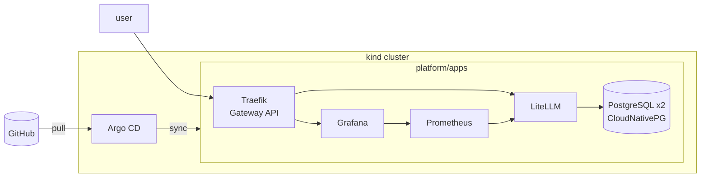

# hackops-ai-platform

hackops-ai-platform is an LLM gateway for hackathons, with per-team API keys, budgets, rate limits, and usage dashboards.
It runs LiteLLM, PostgreSQL, Prometheus, and Grafana on Kubernetes, managed with GitOps through Argo CD.

## Architecture



## Requirements

- [Docker](https://docs.docker.com/engine/install/)
- [kind](https://kind.sigs.k8s.io/docs/user/quick-start/#installation)
- [kubectl](https://kubernetes.io/docs/tasks/tools/)
- [Helm](https://helm.sh/docs/intro/install/)
- [kubeseal](https://github.com/bitnami/sealed-secrets#kubeseal)
- [jq](https://jqlang.org/download/)

## Deploy

1. Fork the repo and replace `pluvivanto/hackops-ai-platform` under `platform/` with your fork.
2. Create the cluster and bootstrap Argo CD:

   ```sh
   kind create cluster --config cluster/kind.yaml
   helm install argocd argo-cd --repo https://argoproj.github.io/argo-helm --version 10.11.6 -n argocd --create-namespace
   kubectl apply -f platform/root.yaml
   ```

3. Re-seal the secrets for your cluster with `kubeseal` and push:
   - `platform/litellm/litellm-masterkey.yaml`: `masterkey`
   - `platform/monitoring/grafana-admin.yaml`: `admin-user`, `admin-password`
4. Run `./scripts/test-teams.sh` once all apps are healthy.

Endpoints:

- <http://argocd.localtest.me>
- <http://grafana.localtest.me>
- <http://alertmanager.localtest.me>
- <http://llm.localtest.me>

## Usage

```console
$ ./scripts/create-team.sh team-foo "Team Foo"
sk-...
$ curl http://llm.localtest.me/v1/chat/completions \
    -H "Authorization: Bearer sk-..." \
    -H "Content-Type: application/json" \
    -d '{"model": "<model>", "messages": [...]}'
$ ./scripts/delete-team.sh team-foo
```

Models are configured in `platform/apps/litellm.yaml`.

## License

[MIT](LICENSE)
