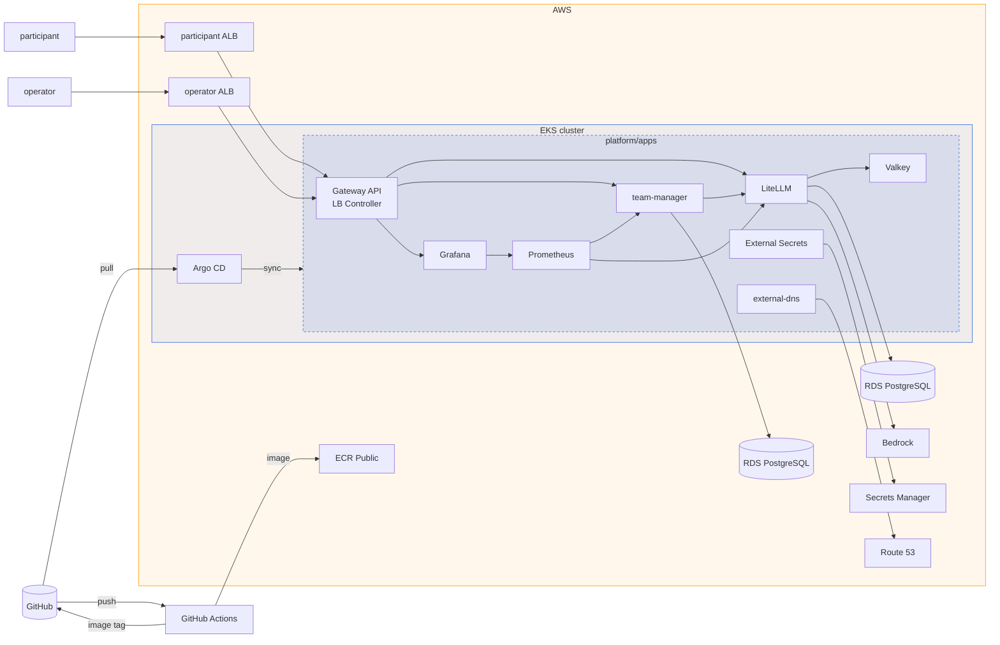

# canteen

canteen is a self-hosted LLM gateway that gives every hackathon team its own Claude API and takes key management off your hands. Deploy it to your AWS account, create the teams, and the event is ready.

With canteen, you can:

- Give each team its own API key, budget, and rate limit
- Let teams get and replace their key on a self-service page
- Use Claude on Amazon Bedrock without storing a provider API key
- Keep admin tools off the venue network
- Keep the API up when a node fails
- Track requests, errors, latency, tokens, and spend for each team
- Rebuild the whole platform from code for every event

## Architecture



## Deploy

Requirements: [AWS CLI](https://docs.aws.amazon.com/cli/latest/userguide/getting-started-install.html), [Terraform](https://developer.hashicorp.com/terraform/install), [kubectl](https://kubernetes.io/docs/tasks/tools/), [Helm](https://helm.sh/docs/intro/install/), [GitHub CLI](https://cli.github.com/), [jq](https://jqlang.org/download/), and an AWS account with a GitHub OIDC provider.

1. Fork the repository.

2. Fill in the settings:

   ```sh
   cp infra/terraform.tfvars.example infra/terraform.tfvars
   cp infra/dns/terraform.tfvars.example infra/dns/terraform.tfvars
   ```

3. Create the DNS zone:

   ```sh
   terraform -chdir=infra/dns init
   terraform -chdir=infra/dns apply   # set the printed name servers at your registrar
   ```

4. Create the cluster and install Argo CD:

   ```sh
   terraform -chdir=infra init
   terraform -chdir=infra apply
   aws eks update-kubeconfig --name hackathon --region ap-northeast-1
   helm install argocd argo-cd --repo https://argoproj.github.io/argo-helm --version 10.11.6 -n argocd --create-namespace
   kubectl apply --server-side -f https://github.com/kubernetes-sigs/gateway-api/releases/download/v1.6.3/standard-install.yaml
   kubectl apply -f platform/root.yaml
   ```

5. Point CI at your account and build the team-manager image:

   ```sh
   gh secret set AWS_ROLE_ARN --body "$(terraform -chdir=infra output -raw github_ci_role_arn)"
   gh workflow run team-manager.yml
   ```

6. Test:

   ```sh
   # confirm the SNS email, wait until all apps are healthy
   ./scripts/test-teams.sh
   ```

Rebuild: steps 4 and 5.

Tear down:

```sh
kubectl delete -f platform/root.yaml
kubectl -n argocd delete application gateway
# wait until both ALBs are gone
terraform -chdir=infra destroy
```

Load test with [k6](https://grafana.com/docs/k6/latest/set-up/install-k6/): `TOKEN=<admin token> k6 run scripts/load-test.js`

## Endpoints

Participants, from `venue_cidrs`:

- `https://team.<domain>`: team page
- `https://llm.<domain>`: LLM API

Operators, from `admin_cidrs`:

- `https://argocd.<domain>`
- `https://grafana.<domain>`
- `https://alertmanager.<domain>`
- `https://llm-admin.<domain>`: LiteLLM admin
- `https://team-admin.<domain>`: team admin API

## Usage

Create a team:

```console
$ curl https://team-admin.<domain>/teams \
    -H "Authorization: Bearer <admin token>" \
    -d '{"display_name": "Team Foo"}'
{"id":"team-abc234","display_name":"Team Foo",...}
```

Delete a team:

```console
$ curl -X DELETE https://team-admin.<domain>/teams/team-abc234 \
    -H "Authorization: Bearer <admin token>"
```

Get the admin token:

```sh
kubectl -n team-manager get secret team-manager-admin -o jsonpath='{.data.token}' | base64 -d
```

Models: `platform/apps/litellm.yaml`, and `bedrock_models` in `infra/bedrock.tf` for Bedrock.

## License

[MIT](LICENSE)
